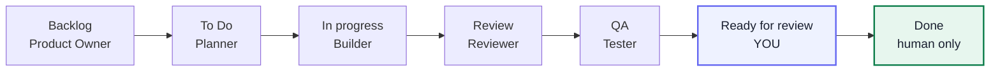

# kanban-multiagent-implementation (Claude Code skill) — v2.5

Drives implementation from a Notion Kanban board using **ten role-scoped agents**,
each a specialist at one job: a **Product Owner** that turns an idea into a tagged
backlog, a **Planner** that decomposes and writes acceptance tests, **Builders** that
implement test-first, and independent **Reviewer** and **Tester** agents that check
the work without inheriting the Builder's reasoning — all coordinated by an
**Orchestrator** that owns the board and never writes code. Agents advance tickets to
**Ready for review**; only you move a ticket to **Done**.

**Surface-adaptive:** one board drives **web, Android, and iOS**. Every ticket carries
a surface tag and the orchestrator spawns the matching build/test pair.

> 📊 **[Open the visual Agent Board](https://amer-hassani.github.io/kanban-multiagent-implementation/)**
> — every agent's kit, craft, and enforced limits on one page.

## The pipeline



**Simple path** (most tickets): Planner writes one failing test → Builder → Tester
confirms. **Risky path** (more than one file, or shared/critical code): full acceptance
tests → Builder → Reviewer *and* Tester, looping up to 4 combined rounds.

## What's in this skill

```
kanban-multiagent-implementation/
├── SKILL.md                            the workflow + setup
├── README.md                           this file
├── V2_NOTES.md                         the full audit/design record behind v2
└── templates/                          copied into your project at setup
    ├── agents/                         each file = one agent's tools + craft
    │   ├── kanban-product-owner.md
    │   ├── kanban-orchestrator.md
    │   ├── kanban-planner.md
    │   ├── kanban-builder-web.md
    │   ├── kanban-builder-android.md
    │   ├── kanban-builder-ios.md
    │   ├── kanban-reviewer.md
    │   ├── kanban-tester-web.md
    │   ├── kanban-tester-android.md
    │   └── kanban-tester-ios.md
    ├── hooks/                          PreToolUse limits, per agent
    │   ├── _path-guard.js              shared path matcher
    │   ├── planner-test-files-only.js
    │   ├── tester-test-files-only.js
    │   ├── deny-acceptance-test-edits.js
    │   └── reviewer-readonly-bash.js
    └── settings.kanban.json            session-wide permissions (enforcement)
```

Each agent file carries three things: its **kit** (which tools it may use), its
**craft** (the elite methodology written into its instructions — how a world-class
professional in that role actually works), and its **enforcement** (tool scoping plus
the hook that limits its paths and commands). The `settings.kanban.json` adds the
session-wide rules that agent frontmatter can't express (secret protection, denied
irreversible operations, human-only ops).

## Install

Personal (all projects): `cp -R kanban-multiagent-implementation ~/.claude/skills/`
Project (shared): `cp -R kanban-multiagent-implementation <repo>/.claude/skills/`

Then restart Claude Code (or run `/skills`) to confirm it's listed.

## Prerequisites

The skill's **setup step checks these for you and walks you through anything
missing** — you don't need to install up front. Mobile tools are only checked if the
project actually has that surface, and iOS only on a Mac.

- **Notion MCP** connected to your board — required (the one true blocker).
- **Playwright MCP** — `claude mcp add playwright npx @playwright/mcp@latest` (web Tester).
- **Maestro** — drives the Android emulator and iOS Simulator (mobile Testers); `maestro mcp` exposes it.
- **Xcode** — required on macOS for the iOS surface. Not applicable elsewhere.
- **Superpowers** — `/plugin install superpowers@claude-plugins-official` (Builders, optional).
- **Chrome DevTools MCP** — `/plugin install chrome-devtools-mcp@claude-plugins-official` (optional).
- Already built-in, nothing to do: `/code-review`, `/security-review`, `/verify`, Plan Mode.

## Use

Paste the starter prompt from `SKILL.md` (bottom), replacing `<paste Notion board
link>`. A normal Claude Code session runs the one-time setup (detects your OS,
installs the agent files and hooks, merges the permissions, proposes your risky-code
list in plain language) — then you launch the orchestrator, which works tickets one at
a time.

**What to expect:** tickets stop at **Ready for review**, not Done. You'll get
plain-language evidence (what changed, how to try it, screenshots) and move the ticket
to Done yourself. You'll be asked before `git push`, deploys, or any new dependency.

## How it works, briefly

The Orchestrator does not grant tools at runtime — it spawns the right pre-equipped
agent **by name**, and that agent is born already holding its kit and craft. The
Orchestrator only passes **this ticket's context**, and enforces the Reviewer's and
Tester's independence by *omitting* the Builder's reasoning from their prompt.
Isolation is an act of omission, not a tool.

It also never re-runs tests itself (it has no Bash). A self-reported "tests pass" is
never accepted as evidence — a freshly spawned Tester has to confirm independently.

See `V2_NOTES.md` for the full design record — the audits, the per-agent findings,
the elite-craft research, and the curated tool kit that produced this version.
