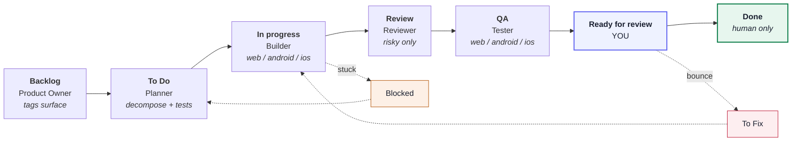
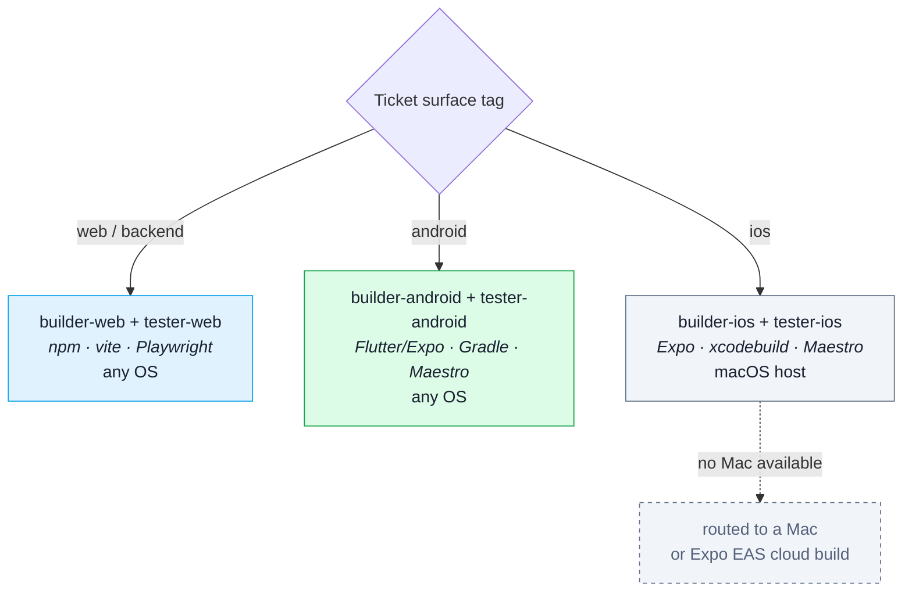

# kanban-multiagent-implementation — v2.5

A Claude Code skill that drives implementation from a Notion Kanban board using
**ten role-scoped agents**, each a specialist at one job — with the best tools
for it (kit), a world-class professional's methodology written into it (craft),
and its restrictions enforced by real config (not just requested).

**Surface-adaptive:** one board drives **web, Android, and iOS** from the same
pipeline. Every ticket carries a surface tag; the orchestrator spawns the matching
build/test agents. iOS builds/tests locally on **macOS**; from Windows/Linux the
iOS *code* is written from the same Expo/React Native codebase and its build routes
to a Mac or a cloud build (Expo EAS) — the skill detects the host OS at setup and
tells the operator honestly what runs locally.

> 📊 **[Open the visual Agent Board](docs/agent-board.html)** — every agent's kit,
> craft, and enforced limits on one page. Download it and open it in any browser.

## The pipeline



**Agents never move a ticket to Done — only you do.** Work stops at *Ready for
review* with plain-language evidence attached: what changed, how to try it, and a
screenshot where the change is visual.

## The ten agents

| Agent | Role |
|---|---|
| **Product Owner** | idea → prioritized backlog of user stories; tags each story's surface; advises |
| **Orchestrator** | owns the board, WIP limit, and log; routes tickets by surface; spawns the others; never codes |
| **Planner** | triage, order, decompose, author acceptance tests (web + mobile checklists) |
| **Builder — web** | web/backend, test-first, smallest change, commits at green |
| **Builder — android** | Android (Flutter/Expo), test-first, mobile musts (permissions, offline) |
| **Builder — ios** *(macOS)* | iOS (Flutter/Expo), test-first, Info.plist/HIG musts |
| **Reviewer** | independent correctness + security review (web + mobile) |
| **Tester — web** | drives the web app (Playwright), attacks edge cases, plain-language evidence |
| **Tester — android** | drives the Android app on an emulator (Maestro), mobile attacks |
| **Tester — ios** *(macOS)* | drives the iOS app on the Simulator (Maestro), mobile attacks |

The thinking agents (PO, Planner, Reviewer) are one file each and handle every
surface; the hands-on agents (Builder, Tester) come in web, android, and ios variants.

## How a ticket gets routed



## What's in the skill

```
.claude/skills/kanban-multiagent-implementation/
├── SKILL.md            the workflow, setup, surface routing, agent roster
├── README.md           skill-level readme + install
├── V2_NOTES.md         the full design + audit record behind every decision
└── templates/          copied into your project at setup
    ├── agents/*.md      the 10 agent definitions (tools + craft + enforcement)
    ├── hooks/*.js       5 PreToolUse hooks for per-agent path/Bash limits
    └── settings.kanban.json   session-wide permissions (secrets, irreversible ops)

docs/
└── agent-board.html    the visual board — all ten agents, kit/craft/enforcement
```

## Enforcement is real (and its honest limit)

Restrictions are config, not requests: tool scoping via **denylists** in each agent
file, per-agent path and command limits via **PreToolUse hooks**, and secrets plus
irreversible operations via **session-wide settings**. The hooks are smoke-tested by
execution — the Android Tester really is denied writing `lib/main.dart` and really is
allowed to write a Maestro `.yaml`.

**The honest limit:** hooks and permission rules are best-effort, not a hard security
boundary. They block the obvious bypasses; for a guaranteed one, enable Claude Code's
OS sandbox. This is built for supervised use with a human gate before anything ships —
not as a defence against a hostile agent.

## Install

```bash
# Personal (all your projects):
cp -R .claude/skills/kanban-multiagent-implementation ~/.claude/skills/

# Or per-project: copy it into the repo you want to use it in, then
# restart Claude Code (or run /skills) to confirm it's listed.
```

See `.claude/skills/kanban-multiagent-implementation/SKILL.md` for the full setup
step, prerequisites, and the starter prompt.

## Status

Built, wired, and verified against the Claude Code docs; enforcement is proven by
execution (the hooks actually deny/allow). Not yet run end-to-end on a live board —
treat the first run as a shakeout with one small ticket. Full rationale for every
design decision is in `V2_NOTES.md`.
