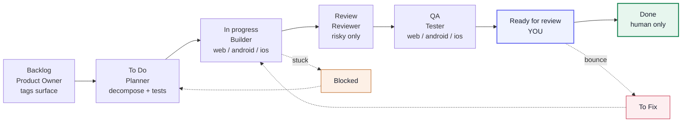

# kanban-multiagent-implementation — v2.5

A Claude Code skill that drives implementation from a Notion Kanban board using
**ten role-scoped agents**, each a specialist at one job — with the best tools
for it (kit), a world-class professional's methodology written into it (craft),
and its restrictions enforced by real config (not just requested).

**Surface-adaptive:** one board drives **web, Android, and iOS** from the same
pipeline. Every ticket carries a surface tag; the orchestrator spawns the matching
build/test agents. iOS builds/tests locally on **macOS**; from Windows/Linux the
iOS *code* is written from the same Expo/React Native codebase and its build routes
to a Mac or a cloud build (Expo EAS) — the skill detects the host OS at setup and
tells the operator honestly what runs locally.

### 📊 [**Open the visual Agent Board →**](https://amer-hassani.github.io/kanban-multiagent-implementation/)

The same content as this page, laid out as colour-coded cards. Everything below is
the plain-text version of that board, so nothing is lost if you stay here.

---

## The pipeline



**Agents never move a ticket to Done — only you do.** Work stops at *Ready for
review* with plain-language evidence attached: what changed, how to try it, and a
screenshot where the change is visual.

The **Product Owner** runs first, turning an idea into a tagged backlog. The
**Orchestrator** — the main session, and the only agent that writes to the board —
reads each ticket's surface and spawns the matching agents. It never codes.

**Two paths.** Simple tickets get Planner → Builder → Tester. A ticket becomes
*Risky* if it touches more than one file or any shared/critical code, and then adds an
independent Reviewer, looping up to 4 combined rounds before it goes to Blocked.

## How a ticket gets routed


| Surface | Agents | Runs where |
|---|---|---|
| `web` / `backend` | builder-web + tester-web | any OS |
| `android` | builder-android + tester-android | any OS |
| `ios` | builder-ios + tester-ios | macOS only — else a Mac host or Expo EAS |

---

## The ten agents

Each agent carries three things: its **kit** (the tools it may use), its **craft**
(the elite methodology written into its instructions), and its **enforcement** (what
it is actually prevented from doing, in config).

Legend for kit: **built-in** = ready now · **install** = one-time setup ·
**verify** = confirm it's connected · **macOS** = Mac host only.

### 🟣 Product Owner — *product, first agent*

Idea → prioritized backlog of user stories. Tags each story's surface. Advises on product.

- **Kit** — PM skills *(install)* · Notion MCP *(verify)*
- **Craft**
  - Outcomes, not output — a backlog is a bet on results
  - Connextra format with a *specific persona* — "As a user" is banned
  - Split vertically by a named method (SPIDR)
  - Mobile story-classes: permissions · offline · push · store release
- **Enforced by** — denylist: no code edit, no Bash; keeps Notion + Skill access

### 🔵 Orchestrator — *coordinator, main session*

Owns the board, the log, and the WIP limit. Routes each ticket by surface; spawns the others; never codes.

- **Kit** — Notion MCP *(verify)* · Agent tool *(built-in)* · `--max-budget-usd` cost cap *(built-in)*
- **Craft**
  - Verify the artifact, never a self-reported "done"
  - Route by surface — web / android / ios / backend
  - Triage by reversibility; act on early drift
  - Off a Mac, an iOS ticket is flagged for cloud build — never called "verified locally"
  - Keeps its run-state *in the board itself* — it has no filesystem
- **Enforced by** — runs as the main session (never spawned as a subagent) · denylist blocks Edit/Write/Bash · setup's file-operations moved to a separate session in v2.5

### 🟠 Planner — *architect, all surfaces*

Triage, order, decompose (web + mobile checklists), author the acceptance tests.

- **Kit** — GitHub Spec-Kit *(install)* · plan-in-prose fallback *(built-in)*
- **Craft**
  - Slice vertically — each task ships end-to-end value
  - Sequence by risk; run a premortem first
  - Criteria as Given-When-Then, never adjectives
  - Mobile: split permission states and offline behaviour, per surface
- **Enforced by** — hook: writes test files only ✓ *proven by execution*

### 🟢 Builder — *implementer, 3 surface variants*

Test-first. The smallest change that fully solves it — and only that.
`builder-web` · `builder-android` · `builder-ios`

- **Kit** — Superpowers for risky/TDD *(install)* · `npm · vite` *(web)* · `flutter · expo · gradlew` *(android)* · `expo · xcodebuild · simctl` *(ios, macOS)* · Chrome DevTools + Postgres MCP for debugging *(install)*
- **Craft**
  - Match the codebase before writing anything
  - Smallest change; solve only this problem
  - Duplication over the wrong abstraction — wait for the third instance
  - Mobile: stable element IDs for testability · four permission states · offline
  - iOS: an Info.plist usage string per capability (missing = instant crash) · HIG, not Material
- **Enforced by** — hook: can't edit acceptance tests ✓ *proven* · works on a branch, never main

### 🔴 Reviewer — *critic, risky tickets, all surfaces*

Independent check — sees the diff, never the Builder's reasoning.

- **Kit** — `/code-review` *(built-in)* · `/security-review` *(built-in)* · Semgrep MCP for SAST *(install)*
- **Craft**
  - Build concrete failure scenarios, not "looks right?"
  - Audit for what is *absent* — missing tests, unhandled errors
  - Back objections with a fact; refuse to bikeshed
  - Mobile: permissions · offline · insecure storage · testability
- **Enforced by** — denylist: no write + hook: read-only Bash ✓ *proven* · shell-redirect writes now blocked as of v2.5

### 🔷 Tester — *QA, risky + evidence, 3 surface variants*

Drives the real app. Proves it ran — never asserts from memory.
`tester-web` · `tester-android` · `tester-ios`

- **Kit** — Playwright MCP *(web, install)* · Maestro MCP on the emulator *(android, install)* · Maestro MCP + `simctl` on the Simulator *(ios, macOS)* · `/verify` *(built-in)*
- **Craft**
  - Test to disprove, not to confirm
  - Attack every boundary: 0, 1, 2 … max−1, max, max+1
  - Fire the nasty-data arsenal: empty, huge, unicode, injection
  - Mobile: permissions · offline mid-action · lifecycle · back gesture
  - One Maestro flow drives both Android and iOS
- **Enforced by** — hook: test files only ✓ *proven* · Maestro `.maestro/` flows allowed as of v2.5

---

## Enforcement is real (and its honest limit)

Restrictions are config, not requests: tool scoping via **denylists** in each agent
file, per-agent path and command limits via five **PreToolUse hooks**, and secrets
plus irreversible operations via **session-wide settings**. The hooks are smoke-tested
by execution — the Android Tester really is denied writing `lib/main.dart` and really
is allowed to write a Maestro `.yaml`.

**The honest limit:** hooks and permission rules are best-effort, not a hard security
boundary. They block the obvious bypasses; for a guaranteed one, enable Claude Code's
OS sandbox. This is built for supervised use with a human gate before anything ships —
not as a defence against a hostile agent.

## Version history

| | |
|---|---|
| **v2.5** | Full audit pass, 30 findings fixed. The load-bearing three: setup's file-operations moved off the write-free Orchestrator (it couldn't perform them); the path guard now allows Maestro `.maestro/` flows, so mobile tickets stop stalling; the Reviewer's "read-only" shell rule now actually blocks writes by redirection — it was bypassable. |
| **v2.4** | iOS became a first-class surface — its own Builder and Tester, Maestro driving the iOS Simulator, availability **detected from the host OS at setup** rather than assumed. Roster went from eight agents to ten. |
| **v2.3** | Surface-adaptive: web/Android split for Builder and Tester, the Product Owner agent, and mobile craft. |
| **v2.2** | Processed 48 audit findings; fixed wiring against the real docs. |
| **v2.1** | Switched tool scoping from `tools:` allowlists to `disallowedTools:` denylists (an allowlist silently strips MCP + skills); per-agent limits moved into PreToolUse hooks. |

## What's in the repo

```
.claude/skills/kanban-multiagent-implementation/
├── SKILL.md            the workflow, setup, surface routing, agent roster
├── README.md           skill-level readme + install
├── V2_NOTES.md         the full design + audit record behind every decision
└── templates/          copied into your project at setup
    ├── agents/*.md      the 10 agent definitions (tools + craft + enforcement)
    ├── hooks/*.js       5 PreToolUse hooks for per-agent path/Bash limits
    └── settings.kanban.json   session-wide permissions (secrets, irreversible ops)

docs/
└── index.html          the visual Agent Board (served at the link above)
```

## Install

```bash
# Personal (all your projects):
cp -R .claude/skills/kanban-multiagent-implementation ~/.claude/skills/

# Or per-project: copy it into the repo you want to use it in, then
# restart Claude Code (or run /skills) to confirm it's listed.
```

See `.claude/skills/kanban-multiagent-implementation/SKILL.md` for the full setup
step, prerequisites, and the starter prompt.

## Status

Built, wired, and verified against the Claude Code docs; enforcement is proven by
execution (the hooks actually deny/allow). Not yet run end-to-end on a live board —
treat the first run as a shakeout with one small ticket. Full rationale for every
design decision is in `V2_NOTES.md`.
